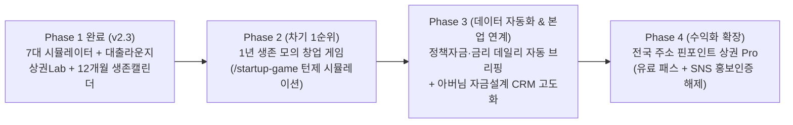

# BoozaThink 차기 로드맵 & 데일리 콘텐츠·디테일 증식 플레이북

> **문서 목적**: `https://boozathink.com`을 단발성 방문 계산기를 넘어 **대한민국 700만 자영업자·예비창업자·셀러가 매일 아침 확인하고 스레드·단톡방에 공유하는 1위 비즈니스 인텔리전스 플랫폼**으로 성장시키기 위한 **차기 개발 로드맵(모의 창업 게임·상권 Pro·자금 CRM)** 및 **매일 덧붙일 데일리 콘텐츠·마이크로 기능 연구서**입니다.

---

## Part 1. 차기 핵심 기능 로드맵 (Phase 2 ~ Phase 4)

### 1-1. [Phase 2 상세 보관안] 「1년 생존 모의 창업」 턴제 경영 게임 모드 (`/startup-game`)

기존 [startup-profiles.js](../backend/data/startup-profiles.js)의 12개월 계절지수와 [calc-engine.js](../backend/public/js/calc-engine.js)의 실측 세법·주휴수당·원리금 엔진을 그대로 구동 코어로 사용하는 **‘리얼리티 100% 창업 생존 시뮬레이션’**입니다.

#### A. 게임 루프 및 상태 구조 (`GameState`)
- **초기 세팅 (0턴 · 오픈 D-30)**:
  1. `seedCapital`: 시작 자기자본 선택 (`3,000만` / `6,000만` / `1억 원`)
  2. `profileId`: 10대 업종 중 택 1 (예: 테이크아웃 커피, 치킨 배달점, 무인 아이스크림, 스마트스토어 사입 등)
  3. `zoneId`: 5대 상권 중 택 1 (역세권 A급 고월세·고유동 vs 아파트 배후 B급 안정형 등)
  4. `fundingChoice`: 부족 자금 조달 방식 선택
     - *선택지 A*: 오픈이 3주 늦어지지만 **지역신보 이차보전 특례보증(연 2.8%)** 대기
     - *선택지 B*: 당장 다음 주 오픈을 위해 **고금리 사업자 신용·캐피탈(연 8.9%)** 즉시 실행
  5. `taxReserveOn`: 매달 매출의 5%를 ‘부가세·종소세 별도 통장’에 자동 분리 적립할지 여부 선택

- **본 게임 진행 (1월 ~ 12월 · 총 12턴 또는 분기별 6턴)**:
  - 매 턴 종료 시: `당월 매출(계절지수 × 이벤트 보정)` − `식자재·포장원가` − `플랫폼 수수료·배달비` − `월세·관리비` − `인건비(주휴·4대보험)` − `대출 원리금`이 차감되어 **실시간 사업용 통장 잔고(`cashBalance`)**가 변동됩니다.
  - **현실 세무 쇼크 엔진**: `7월(제1기 확정 부가세)`과 `1월 결산(제2기 확정 부가세 + 종소세 추산)` 턴에 누적 세금이 일시 출금됩니다. 세금 통장을 안 만들어 둔 플레이어는 장부상 흑자여도 통장 잔고가 마이너스가 되는 **‘흑자 부도(긴급 수혈 이벤트)’**를 겪습니다.

#### B. 월별 현실 딜레마 이벤트 카드 풀 (36종 설계 기준)
| 시즌 / 월 | 현장 딜레마 상황 | 선택지 A (공격형) | 선택지 B (수익방어형 · 권장) | 선택지 C (시설·제도 활용형) |
|---|---|---|---|---|
| **3월 (개강·봄)** | 반경 200m 내 경쟁 매장이 오픈 기념 3,000원 할인 쿠폰 살포 | 맞불 3,000원 쿠폰 (주문 +30%, 마진율 −12%p) | **포장(픽업) 2,500원 할인 배너 집중** (배달비 절감으로 순익 방어) | 고마진 사이드 세트 신설로 객단가 +3,500원 유도 |
| **5월 (구인난)** | 주말 피크타임 알바생 퇴사 및 시급 인상 요구 | 주 25시간 1명 채용 (주휴수당+4대보험 절벽 발생) | **피크타임 주 14시간 파트타임 2명 쪼개기 채용** | **스마트상점 국비 70% 신청 후 테이블오더 도입** |
| **7월 (폭염·부가세)** | 냉방 전기요금 급증 + 제1기 부가세 납부 고지서 도착 | 마이너스통장/현금서비스로 급전 납부 (이자 급증) | **신용카드 발행세액공제(1.3%)·의제매입 꼼꼼 반영 후 납부** | 매출 급감 시 납부기한 연장 제도 신청 |
| **9월 (원가 폭등)** | 이상기후·환율 상승으로 주력 식자재·사입 원가 14% 급등 | 기존 가격 고수 (원가율 상승 감수) | 대표 메뉴 1,000원 인상 + 단골 리워드 쿠폰 지급 | 산지 직거래/대용량 패키징 변경으로 원가율 4%p 절감 |
| **11월 (금리·비수기)** | 한파 시작과 함께 매출 20% 하락 + 고금리 이자 부담 가중 | 버티기 (예비자금 소진) | **소상공인 연 4.5% 저금리 대환대출 갈아타기 실행** | 겨울 시즌 한정 고단가 메뉴·단체배달 영업 개시 |

#### C. 1년 결산 성적표 & 바이럴 확산 장치
- **최종 산출 지표**: 12개월 후 통장 순현금 증감, 초기 매몰투자비 회수율(%), 총 납부 세금·이자 합계, 동종업종 플레이어 중 **상위 몇 %(`public.biz_game_runs` RLS ON 익명 랭킹)**인지 판정.
- **현실 고증 칭호(Badge) 시스템**:
  - `상위 3% 숫자에 밝은 실전 장사 고수` (원금 50% 이상 회수 + 무적자 완주)
  - `배달앱과 건물주만 행복하게 해준 성실한 사장님` (연매출 3억 돌파했으나 순수익률 5% 미만)
  - `7월 부가세 폭탄에 통장이 얼어붙은 초보 창업가` (세금 미적립으로 현금 고갈 경험)
- **원클릭 결과 영수증 PNG + 복기 퍼널**:
  - 가장 뼈아팠던 실수 2가지를 짚어주며 [사업자 대출·정책자금 라운지](../backend/views/funding.js) 또는 해당 정밀 계산기로 즉시 이동시켜 체류시간과 상담 전환율을 극대화합니다.

---

## Part 2. 매일 어떤 내용을 덧붙일 것인가? — 데일리 콘텐츠 & 디테일 연구

구글 SEO·애드센스 고단가(금융·세무·B2B CPC 상위권) 트래픽과 재방문율을 동시에 끌어올리려면, 무작위 블로그 글이 아니라 **‘숫자 검증 표 + 3초 미니 계산기 + 계산기 프리셋 확장’**이 결합된 구조화된 자산을 매일 1단위씩 쌓아야 합니다.

### 2-1. 요일별(월~일) 데일리 증식 포맷 (주간 고정 루틴)

| 요일 | 데일리 테마 | 매일 덧붙일 구체적 구성물 | 연결 허브 |
|---|---|---|---|
| **월요일** | **정책자금 · 금융권 금리 브리핑** | • 이번 주 접수 중인 소진공·중진공·17개 시도 신용보증재단 이차보전 공고 3~5건 요약 • 시중은행·인터넷은행·증권사 금리 밴드([rates.js](../backend/lib/rates.js)) 주간 점검 및 대환 사례 1편 | `/funding` `/calculators/policy-funds` |
| **화요일** | **세부 업종 원가 해부 & 프리셋 추가** | • 요즘 뜨는 세부 업종 1개의 실제 투자비·식자재율·포장비·계절지수 해부 리포트 • 동시에 [startup-profiles.js](../backend/data/startup-profiles.js)에 해당 업종 프로파일 1개 실제 코드 추가 (20개→50개 확장) | `/calculators/startup-master` `/calculators/delivery-margin` |
| **수요일** | **이커머스 · 소싱 · 광고 마진 실험실** | • 스마트스토어·쿠팡·공동구매·알리/테무·해외직구 카테고리별 수수료·물류·반품률 실측 글 • 위안화/달러 환율 변동에 따른 손익분기 ROAS 변화 시나리오 | `/calculators/seller-roas` `/category/ecommerce-seller-lab` |
| **목요일** | **세무 · 노무 · 상가임대차 실전 방어** | • 해당 월([calendar-events.js](../backend/data/calendar-events.js)) 세무·노무 이슈와 직결된 절세·가산세 방지 가이드 • 임대차 특약 문구 예시, 퇴직금·주휴·연차 판례 기반 계산 사례 | `/calendar` `/calculators/vat-income-tax` |
| **금요일** | **전국 핵심 상권 · 입지 해부 리포트** | • 실제 주요 상권(예: 성수 연무장길, 판교 오피스, 김포 신도시 항아리상권 등) 1곳의 평당 임대료·배후 연령대·생존 업종 분석 | `/commercial-area` `/calculators/store-rent-breakeven` |
| **토요일** | **초경량 마이크로 계산기 / 기능 디테일** | • 사장님들이 단톡방에서 자주 묻는 단일 주제 마이크로 도구 또는 체크리스트 1종 추가 (아래 2-3 목록 참조) | `/calculators` |
| **일요일** | **주간 인기 데이터 리포트 & 스레드 카드** | • `/admin` Site-Kit 데이터에서 한 주간 가장 많이 조회·실행된 업종 마진율 익명 통계 요약 + 공유용 카드뉴스 문안 발행 | `/` · SNS 채널 |

---

### 2-2. 바로 실행 가능한 「30일 데일리 업데이트 마스터 플랜」 (Day 1 ~ Day 30)

1. **Day 1 (자금)**: 신용점수 700점대 개인사업자가 제2금융권 대신 지역신보 보증서 먼저 뚫는 실전 순서와 부결 사유 5가지
2. **Day 2 (업종확장)**: `프리미엄 샐러드·포케·그릭요거트 전문점` 창업 프로파일 추가 (여름 성수기 +35%, 겨울 비수기 −25% 로스율 해부)
3. **Day 3 (셀러)**: 쿠팡 로켓그로스 입출고비·장기보관료 폭탄 피하는 재고회전일수(30일 룰) 계산법
4. **Day 4 (세무)**: 창업 첫해 간이과세자 vs 일반과세자 선택 — 인테리어 5,000만 원 부가세 500만 원 환급받는 기준점
5. **Day 5 (상권)**: 3,000세대 대단지 아파트 정문 ‘항아리 상권’에서 살아남는 업종 TOP 5 vs 1년 내 폐업하는 업종
6. **Day 6 (마이크로 도구)**: **알바·직원 1년 이상 근무 시 퇴직금 적립 계산기** 미니 위젯 추가
7. **Day 7 (주간결산)**: 자영업자 시뮬레이션 익명 통계 브리핑 — 외식업 평균 목표 마진율 vs 실제 순마진율 격차 분석
8. **Day 8 (자금)**: 물품대금·보증금 잔금 2주 급할 때 — 카드론(연 14%) vs 증권사 예탁담보대출(연 6%) 이자·신용점수 영향 비교
9. **Day 9 (업종확장)**: `코인세탁소·워시엔조이형 무인 세탁방` 창업 프로파일 추가 (장마철 피크 지수, 가스·수도·전기 고정비 실측)
10. **Day 10 (셀러)**: 네이버 도착보장 vs 자체 3PL 풀필먼트 개당 물류비·전환율 손익분기 비교
11. **Day 11 (노무)**: 가족(배우자·자녀) 채용 시 인건비 경비 인정 요건과 4대보험 가입 기준 완벽 정리
12. **Day 12 (상권)**: 오피스 상권(주 5일 극성수·주말 공동화)에서 월세 400만 원을 버티는 점심 2.5회전 + 정기구독 공식
13. **Day 13 (마이크로 도구)**: **선정산 서비스 수수료 ‘연환산 실질 금리(%)’ 판독기** 추가 (일 0.04%가 연 14.6%임을 직관화)
14. **Day 14 (주간결산)**: 예비창업자들이 가장 많이 시뮬레이션한 업종 TOP 5와 평균 자기자본 비율 리포트
15. **Day 15 (자금)**: 소상공인 정책자금 ‘직접대출’과 ‘대리대출(보증서)’ 동시에 받아 총한도 1.5억 만드는 조합 공식
16. **Day 16 (업종확장)**: `마라탕·마라샹궈 배달·홀 복합매장` 창업 프로파일 추가 (그램당 원가 구조 및 식자재 로스 관리)
17. **Day 17 (셀러)**: 인스타그램·스레드 공동구매(공구) 벤더 수수료(25~35%) 구조에서 제조·사입 셀러가 마진 남기는 가격 설계
18. **Day 18 (임대차)**: 권리금 5,000만 원 주고 들어갈 때 ‘바닥권리·시설권리·영업권리’ 분리 계약서 특약 문구와 감가상각 세무처리
19. **Day 19 (상권)**: 대학가 상권 방학 4개월(1~2월·7~8월) 매출 반토막 버티는 배달 반경 확장 시뮬레이션
20. **Day 20 (마이크로 도구)**: **프랜차이즈 로열티·차액가맹금(물류마진) 숨은 비용 역산기** 추가
21. **Day 21 (주간결산)**: 배달앱 포장 할인 전환 시 업종별 평균 순익 개선액 데이터 리포트
22. **Day 22 (자금)**: 사업자 부동산 담보대출(주택·상가) 실행 시 가계대출 DSR 규제 예외 요건과 금리 감면 팁
23. **Day 23 (업종확장)**: `무인 사진관(인생네컷류) · 소형 파티룸` 창업 프로파일 추가 (초기 부스 감가상각 vs 입지 수명 주기)
24. **Day 24 (셀러)**: 1688·알리바바 사입 시 간이통관 vs 일반수입통관(사업자 통관) 관세·부가세 매입세액공제 결정표
25. **Day 25 (세무)**: 사업용 신용카드 홈택스 등록 누락 시 날아가는 부가세 매입세액공제 항목 총정리 (화물차·경차 유류대 포함)
26. **Day 26 (상권)**: 지하철 환승역 1번 출구 1층 vs 먹자골목 이면도로 1.5층 — 보증금·권리금 대비 실제 순수익률 승자는?
27. **Day 27 (마이크로 도구)**: **폐업 시 점포철거비 국비지원(최대 600만원) vs 무권리 양도양수 손익 비교기** 추가
28. **Day 28 (주간결산)**: 월별 세무·자금 캘린더 기반 다음 달 필수 준비 서류 총정리
29. **Day 29 (자금)**: 법인 전환 타이밍 계산 — 개인사업자 성실신고 구간(종소세 35~45%) vs 법인세(9~19%) 세후 실수령 역전 지점
30. **Day 30 (대형 업데이트)**: **Phase 2 「1년 생존 모의 창업 게임」 시즌 1 정식 오픈!**

---

### 2-3. 앞으로 곳곳에 계속 숨겨 넣을 ‘장인정신 디테일’ 백로그

1. **계산기 결과 ‘한 줄 처방전’ 고도화**: 단순히 *“순마진율 11%입니다”*에서 끝내지 않고, *“원가를 600원 줄이거나 세트 메뉴로 객단가를 3,000원 올리면 월 순익이 +148만 원 늘어납니다”*처럼 **당장 내일 매장에서 실행할 수 있는 숫자 행동 지침** 제시 (현재 배달 픽업 비교·셀러 2개 묶음 비교 적용 완료).
2. **계절·날짜 인지형 인터페이스**: 접속한 날짜에 맞춰 상단 브리핑 바가 매달 자동 전환되도록 구현 완료([calendar-events.js](../backend/data/calendar-events.js)), 추후 공고 마감 D-Day 배지 추가.
3. **현장 계약서 특약 문구 복사 버튼**: 상가 환산보증금 계산기 하단에 *“정화조 용량 미달 또는 영업허가 불가 시 계약금 전액 반환 특약”*, *“현 시설 상태 인도 및 원상복구 범위 한정 특약”* 등 실제 계약 날 복사해 쓸 수 있는 표준 문구 스니펫 제공.
4. **자동화 스케줄 연동**: Antigravity의 `/schedule` 또는 `/automation` 기능을 활용하면 매주 월요일 아침마다 한국은행·소진공 신규 공고 변경사항을 점검해 브리핑 초안을 생성하는 반자동 파이프라인으로 확장할 수 있습니다.
